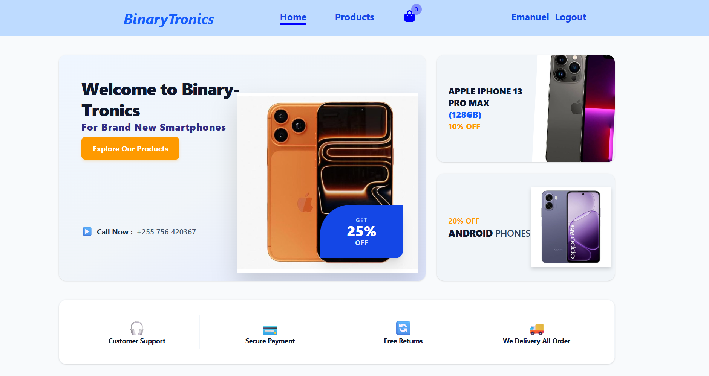

# Binary-Tronics
## Who we are
Binary-Tronics is the online shop for selling electronics devices for personal and office use. For now it specialize on selling smarphones and plan to add other categories like laptops, desktops and others in the future.

## Problem statement

The need of reliable platform that enable clients to buy their devices without nesesarily going phisically to the shop.


## Solution
To create a webplatform that will enable user to view products, search to find some products easly. auser can add selected products to Cart and continuewith their payment anywhere they are. Users will then going to pick their products near where they reside.


## Current features
- Users can view different products in brief or specific product in details and search for specific product to find them easly.
- Users can add products to cart directly from product cards or by visiting specific product in details and add to cart from there.
- Show the cart count on the header.
- Users can view their added to cart products.
- Users can proceed with the checkout process after they have loggec in.

## Future improvements
- Create the admin functionality to enable CRUD functionality
- To use database to manage more data instead of rely on Node.JS with Express.
- Continue with the improvement of the design of the web page with interactivity features by using JavaScript

## Technology
-  HTML – For content and structure of the web pages.
-  CSS – For styling of web pages.
-  React with Vite by using JavaScript - For adding interactivity and programing functionalities to different web pages.
-  Node.js with Express - For backend functionalities such as storing data and handle requests and response to frontend.
-  Git and GitHub – For source control, managing repositories and share repositories.
- Tailwindcss - For styling wepages

### File structure
```
binary-tronics/
├── .gitignore
├── backend/
│   ├── .gitignore
│   ├── data/
│   │   ├── products.json
│   │   └── users.json
│   ├── index.js
│   ├── package-lock.json
│   └── package.json
├── components.json
├── eslint.config.js
├── index.html
├── jsconfig.json
├── LICENSE
├── package-lock.json
├── package.json
├── public/
│   ├── favicon.svg
│   ├── icons.svg
│   └── images/
│       └── products/
│           └── smartphones/
│               ├── apple-iphone-13-pro-max.jpg
│               ├── apple-iphone-17-pro-max.jpg
│               ├── oppo-a6x.jpg
│               ├── redmi-15c.jpg
│               ├── samsung-galaxy-a06.jpg
│               └── samsung-galaxy-a07-4g.jpg
├── README.md
├── src/
│   ├── App.jsx
│   ├── assets/
│   │   ├── hero.png
│   │   ├── react.svg
│   │   └── vite.svg
│   ├── components/
│   │   ├── CartItem.jsx
│   │   ├── Footer.jsx
│   │   ├── Header.jsx
│   │   ├── ProductCard.jsx
│   │   ├── ProductList.jsx
│   │   └── ProtectedRoute.jsx
│   ├── context/
│   │   ├── AuthContext.jsx
│   │   └── CartContext.jsx
│   ├── index.css
│   ├── lib/
│   │   └── utils.js
│   ├── main.jsx
│   └── pages/
│       ├── About.jsx
│       ├── AdminDashboard.jsx
│       ├── Cart.jsx
│       ├── Checkout.jsx
│       ├── Contact.jsx
│       ├── Dashboard.jsx
│       ├── Home.jsx
│       ├── Login.jsx
│       ├── Logout.jsx
│       ├── NotFound.jsx
│       ├── ProductDetails.jsx
│       ├── Products.jsx
│       ├── Register.jsx
│       └── Unauthorized.jsx
└── vite.config.js
```
### Installation and setup
Check the link below to run the project

git clone
```
https://github.com/emanuelnnko-dot/binary-tronics.git
```
**Copy the link** and ***paste on web browser address*** to reach to the project repository on gitHub

### How the project looks like
This is the home page


This is the live URL link on GitHub pages
```
Live URL will be put here
```

### Contribution and collaboration 
It's okay to contribute and collaborate on this project, just follow the steps below:

1. Clone the project

git clone
```
 https://github.com/emanuelnnko-dot/binary-tronics.git
```
2. Make a pull request
3. Document the contribution as an issue

### License 
The project is under MIT license and the author is @emanuelnnko-dot

